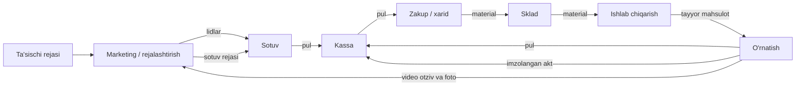

<picture>
  <source media="(prefers-color-scheme: dark)" srcset="../frontend/public/brand/rombo-logo-white.svg">
  
</picture>

# Rombo — business process map

Source: the company's process diagram (2026-10-29). This is the order of modules the ERP follows.
Red = money / material, blue = documents, green = who does the work.

| Stage | People | Receives (documents) | Hands over | Rombo module |
|---|---|---|---|---|
| Marketing | marketing dept. | founder's plan, client videos/photos | leads, sales plan | later |
| Sotuv (sales) | sales dept., showroom | leads | money; **order sheet, drawing, hisob-kitob** | ✅ Loyihalar, Mijozlar, hisob-kitob, shartnoma |
| Kassa | accountant, office | order sheet, drawing, hisob-kitob; money; signed act | money to purchasing | next: payments (advance, remainder) |
| Zakup (purchasing) | purchaser | **purchase request**, drawing, hisob-kitob | material | next: procurement |
| Sklad (warehouse) | warehouse head, storekeepers | purchase request, drawing, hisob-kitob | material; **material issue slip** | after procurement |
| Ishlab chiqarish | production head, assemblers, workshop | copy of issue slip and purchase request; assembler drawing, installer drawing, copy of order sheet | finished product | MRP / production |
| O'rnatish (installation) | installers, site | installer drawing, **acceptance act**, copy of order sheet | money, signed act, video review | installation |

## What this means for the data model
- **Loyiha** is the order sheet ("Лист заказа"). Every document above carries `project_id`.
- **Hisob-kitob** (Счет фактура) lines are the order's material list with quantities.
  Purchasing (Zakup) and MRP read these lines — the purchase request is "hisob-kitob lines minus stock".
- **Chertezh** has two audiences: assembler and installer → drawing kinds later.
- **Akt priema-peredachi** closes the order (Yetkazildi → Yopildi) and goes back to Kassa.
